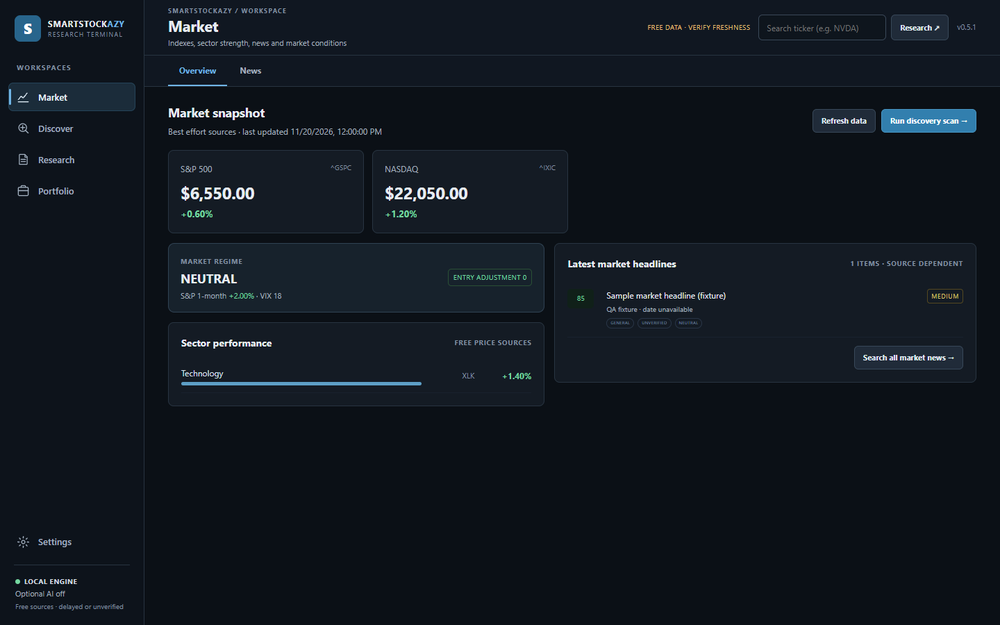
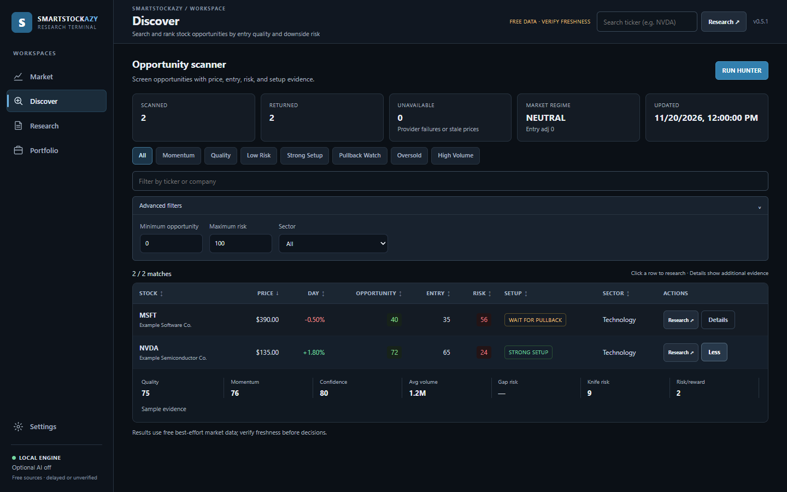
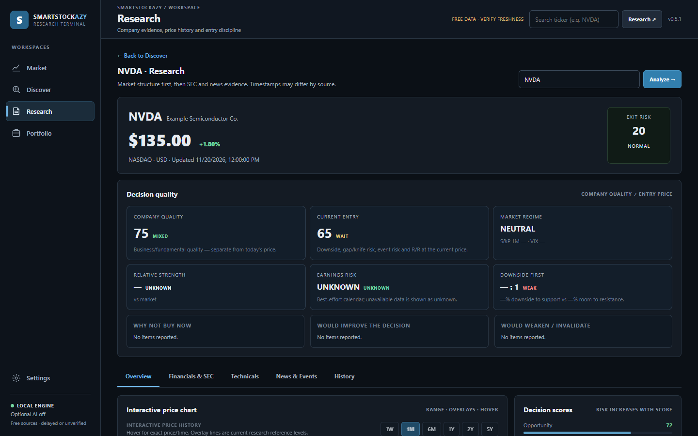

# SmartStockAZY

**A free, local-first stock research terminal for Windows.**

Explore the market, screen stocks, review the evidence behind a potential entry, and monitor your portfolio in one desktop application. Designed to keep **company quality, entry timing, and downside risk** separate.

**[Download for Windows](https://github.com/3AYZE/SmartStockAZY/releases/latest/download/SmartStockAZY.exe)** · [Latest release](https://github.com/3AYZE/SmartStockAZY/releases/latest) · [Setup guide](docs/GETTING_STARTED.md) · [Report an issue](https://github.com/3AYZE/SmartStockAZY/issues/new)

**Windows 10/11 (64-bit)** · **Free to use** · **No Python needed for the EXE** · **Optional local AI**

---

## Preview

<strong>More screenshots — Discover and Research</strong>

### Discover

### Research

*Screenshots use simulated demonstration data. They do not represent live stock quotes or investment results.*

## What you can do

| Workspace | Features |
| --- | --- |
| **Market** | Major indexes, sector performance, market regime, and news |
| **Discover** | Stonk Hunter screening, sortable rankings, and risk filters |
| **Research** | Price charts, company fundamentals, technical indicators, SEC filings, news, and entry/exit analysis |
| **Portfolio** | Holdings, multiple purchase lots, cost basis, profit/loss, risk monitoring, and alerts |
| **Settings** | Data preferences, optional Ollama, and application updates |

### Built for evidence-first research

- **Company vs. price:** Evaluate company quality separately from whether its current stock price is attractive.
- **Downside awareness:** Review overextension, gap/chase risk, falling-knife signals, stabilization, and risk/reward.
- **Source transparency:** Market quotes, financial filings, news reports, and calculated signals are distinguished when available.
- **Portfolio context:** Track lots, weighted cost basis, concentration, thesis health, and possible exit risks.
- **No automatic trading:** SmartStockAZY is a research and monitoring tool, not a brokerage client.

## Get started

1. **[Download SmartStockAZY.exe](https://github.com/3AYZE/SmartStockAZY/releases/latest/download/SmartStockAZY.exe)** from the latest GitHub Release.
2. Save the EXE in a writable folder and open it. The application uses Microsoft Edge or Chrome to display its desktop-style window.
3. Search for a ticker, or open **Discover** to run a stock screen.

**No Python installation or paid API key is required to run the Windows EXE.**

For an older portable installation, existing portfolio data, troubleshooting, and update recovery, read the [Windows setup guide](docs/GETTING_STARTED.md).

## Updates

SmartStockAZY checks for newer **published GitHub Releases** and shows an update option in **Settings → Application Updates**.

1. Select **Check for Updates** if you want to check manually.
2. Select **Download & Verify** when a newer EXE is available.
3. Select **Restart to Install** to approve the replacement.

Updates are **never installed silently**. The updater verifies the downloaded EXE against the published SHA-256 digest and keeps a backup of the previous executable. Portfolio data is stored separately in the local user-data folder.

**Public releases:** Downloads and in-app updates do not require a GitHub account, GitHub CLI, or API key.

See [Setup, updates, and data safety](docs/GETTING_STARTED.md) for details.

## Requirements and limitations

- **Platform:** Windows 10 or 11, 64-bit; Microsoft Edge or Google Chrome recommended for the app-style window.
- **Data:** Best-effort free market/news sources and SEC filings. Quotes, earnings dates, and articles can be delayed, incomplete, or unavailable.
- **AI:** Ollama is optional. Core research works without an AI service.
- **Privacy:** Holdings and application settings are stored locally in SQLite. No brokerage connection or automatic orders are provided.
- **Accuracy:** Research scores, entry zones, and risk signals are heuristic analysis, **not financial advice or guaranteed predictions**.

The Windows build and localhost startup passed automated checks. Live-source behavior, real-world investment accuracy, and end-user EXE update/restart behavior still require manual validation. The EXE is currently **unsigned**; download only from this repository's Releases page.

## Documentation

| Guide | Contents |
| --- | --- |
| [Windows setup guide](docs/GETTING_STARTED.md) | Download, first launch, migration, auto-updates, troubleshooting |
| [Development guide](docs/DEVELOPMENT.md) | Run from source, architecture, tests, build process |
| [Changelog](CHANGELOG.md) | Major changes by version |
| [Reliability audit](docs/audit-report.md) | Data accuracy, risk logic, tests, remaining validation |
| [UI redesign report](docs/ui-redesign-report.md) | Navigation changes, screenshots, responsive checks |

Found a bug or have a suggestion? [Open an issue](https://github.com/3AYZE/SmartStockAZY/issues/new). Please include the app version, steps to reproduce, and what you expected to happen; do not share personal portfolio data or access tokens.
